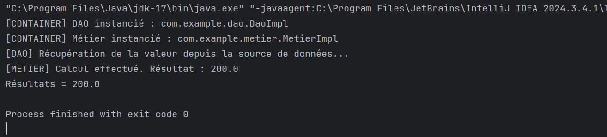
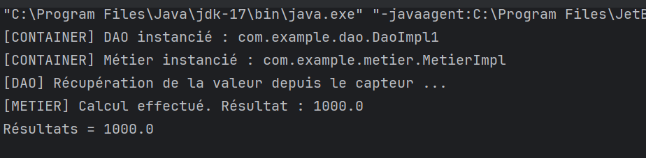

# TP — Injection de dépendances par instanciation dynamique (Réflexion Java)

##  Objectif

Ce TP a pour but de mettre en pratique le principe de **l'injection de dépendances** en Java en utilisant l'**instanciation dynamique** via la **réflexion** (`Class.forName`, `Constructor.newInstance`, `Method.invoke`). L'objectif est de réaliser un **couplage faible** entre les couches DAO, Métier et Présentation, sans aucune dépendance directe dans le code.

---

## Architecture du projet

Le projet suit une architecture en couches :

```
src/main/java/com/example/
├── dao/
│   ├── IDao.java              # Interface DAO
│   ├── DaoImpl.java           # Implémentation DAO (source de données)
│   └── DaoImpl1.java          # Implémentation DAO (capteur)
├── metier/
│   ├── IMetier.java           # Interface Métier
│   └── MetierImpl.java        # Implémentation Métier
├── presentation/
│   └── Presentation2.java     # Point d'entrée (instanciation dynamique)
└── config.txt                 # Fichier de configuration (noms des classes)
```

---

### Fichier de configuration — `config.txt`

Pour utiliser `DaoImpl` (source de données) :
```
com.example.dao.DaoImpl
com.example.metier.MetierImpl
```

Pour utiliser `DaoImpl1` (capteur) :
```
com.example.dao.DaoImpl1
com.example.metier.MetierImpl
```

Ce fichier permet de changer les implémentations **sans recompiler** le code.

---

##  Résultat d'exécution

### Avec `DaoImpl` (source de données — valeur de base = 100.0)



```
[CONTAINER] DAO instancié : com.example.dao.DaoImpl
[CONTAINER] Métier instancié : com.example.metier.MetierImpl
[DAO] Récupération de la valeur depuis la source de données...
[METIER] Calcul effectué. Résultat : 200.0
Résultats = 200.0
```

### Avec `DaoImpl1` (capteur — valeur de base = 500.0)

Après modification du fichier `config.txt` pour pointer vers `DaoImpl1`, on obtient :



```
[CONTAINER] DAO instancié : com.example.dao.DaoImpl1
[CONTAINER] Métier instancié : com.example.metier.MetierImpl
[DAO] Récupération de la valeur depuis le capteur ...
[METIER] Calcul effectué. Résultat : 1000.0
Résultats = 1000.0
```

On constate que le résultat passe de **200.0** à **1000.0** simplement en changeant la ligne du DAO dans `config.txt`, **sans modifier ni recompiler le code**.


## Conclusion

Ce TP démontre comment réaliser une **injection de dépendances par instanciation dynamique** en Java pur, sans framework. Grâce à la réflexion et à un fichier de configuration externe (`config.txt`), le programme atteint un **couplage faible** entre les couches. Il est possible de changer d'implémentation DAO ou Métier simplement en modifiant le fichier `config.txt`, sans toucher au code source ni recompiler l'application.
